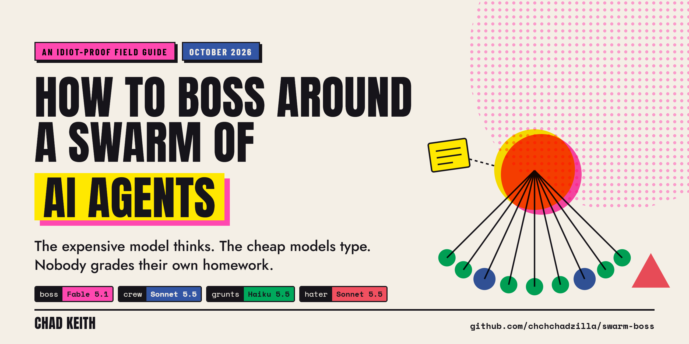

# How to Boss Around a Swarm of AI Agents

**The idiot-proof, step-by-step guide to letting the expensive model think and the cheap models type.**

*Chad Keith · October 2026*

**Every file this guide tells you to copy lives in [`kit/`](https://github.com/chchchadzilla/swarm-boss/tree/main/kit)** -- agent files, the boss rules, the templates, and the script. Grab them from there, not from a PDF.

     

> [!NOTE]
> Prices, model names, and Claude Code features in here are current as of **October 2026**. This stuff changes faster than I can write a LinkedIn post about it, so check the pricing page before you bet a budget on my table.

---

## TL;DR (for the people already scrolling)

1. **Most jobs shouldn't be a swarm.** Run the 30-second test in [section 3](#3-should-you-even-swarm-the-30-second-test) first. If the job doesn't split, one good model at lower effort beats the whole circus, and Anthropic has the numbers to prove it. And more agents doesn't automatically mean faster.
2. **If it does split:** the smartest model plans, decides, and merges. It doesn't do grunt work. Ever.
3. **Brief the workers, don't script them.** The goal, WHY it matters, where to look, one example of a good result, and the boundaries. The 5-family models get worse when you micromanage them.
4. **No receipt, no claim.** Every fact comes back with an exact quote and where it came from, and a dumb for-loop checks that the quote actually exists.
5. **Nobody grades their own homework.** A separate agent (the Hater) tries to break everything before you see it.
6. **Two strikes and a task moves up a tier.**
7. **Model and effort are two different dials.** Know which one you're turning.
8. **The swarm reads. You think.** After every run, make the model teach you what it built, because no number of agents is gunna do your thinking for you.

## Contents

0. [Why I wrote this](#0-why-i-wrote-this)
1. [Meet the cast](#1-meet-the-cast)
2. [What changed with the 5 family (stop yelling at your agents)](#2-what-changed-with-the-5-family-stop-yelling-at-your-agents)
3. [Should you even swarm? (the 30-second test)](#3-should-you-even-swarm-the-30-second-test)
4. [The 8 rules](#4-the-8-rules)
5. [Lane A: Claude Code, step by step (no code)](#5-lane-a-claude-code-step-by-step-no-code)
6. [Lane B: the script](#6-lane-b-the-script)
7. [Two real jobs, start to finish](#7-two-real-jobs-start-to-finish)
8. [When it breaks](#8-when-it-breaks)
9. [Critical thinking is still your job](#9-critical-thinking-is-still-your-job)
10. [Honest limits (you'll find them anyway)](#10-honest-limits-youll-find-them-anyway)
11. [Cheat sheet](#11-cheat-sheet)
12. [Sources](#12-sources)

---

## 0. Why I wrote this

I've shipped something like 35 products in 18 months on under $500 total. I'm not saying that to flex (okay, a little). I'm saying it because you don't pull that off by paying the most expensive model on Earth to rename your files.

Two things pushed me into swarms.

**The one that sold me.** When I built Private Intelligence -- private RAG servers that answer questions out of a client's own documents -- every answer came from ONE agent crawling the whole document pile. Sometimes it took five full minutes to come back. Five minutes, dude. So I rebuilt it to send out up to ten agents to crawl the corpus in parallel and hand their findings to a more capable model to stitch together. Oh my fuckin god, dude. Night and day. Roughly 30 seconds. It costs more, sure. But those four and a half minutes drag like hell, and 30 seconds of waiting at least comes with an insane amount of information attached.

**The one that humbled me.** Back in April I built C-C-C-COOLASSAPP (the Carefully-Crafted-Claude-Code Original Orchestration Layer And Super Serious Appropriately Positioned Project -- I regret nothing), a whole Flask dashboard to babysit ten Claude Code agents at once. Going from one agent to ten broke every damn thing: merge conflicts everywhere, Agent A contradicting Agent B's architecture, and zero idea what any of them were actually doing. Six months later it's a completely different game. The tools handle a lot of that natively now, and most of what's left comes down to how you brief the agents and what you let into their heads. No dashboard fixes that.

I also used to be a zookeeper at the LA Zoo, and honestly? Same job. A bunch of animals that don't read documentation, a feeding schedule, and one person whose whole job is making sure nobody gets eaten. In this guide, that person is you.

---

## 1. Meet the cast

Every swarm in this guide has four roles. The names are dumb on purpose so you remember them.

| Role | Model (Oct 2026) | Price per 1M tokens (in / out) | Its job | Never let it... |
| --- | --- | --- | --- | --- |
| **The Boss** | Claude Fable 5.1 (or Opus 5.5 to cut boss cost 60%) | $10 / $50 | Understand what you need, split the job, make the shared decisions, merge the results | Do bulk reading, tagging, or typing |
| **The Crew** | Claude Sonnet 5.5 | $2 / $10 | Focused work that needs judgment inside a clear brief | Make calls that change what other workers do |
| **The Grunts** | Claude Haiku 5.5 | $0.10 / $0.50* | High-volume, mechanical work: read, tag, extract, search, reformat | Make judgment calls |
| **The Hater** | Claude Sonnet 5.5 (Opus 5.5 when stakes are high) | $2 / $10 | Find what's wrong with work it didn't do | Fix anything. The Hater only reports. |

<small>*Haiku 5.5's price is for prompts up to 100K tokens. Past that it's $0.50 / $2.50. Opus 5.5 is $4 / $20. All four have 1M-token context windows.</small>

See the Grunt row? Fable costs **one hundred times** what Haiku does, per token. ONE HUNDRED. If your top model is summarizing PDFs and renaming files, you're paying a brain surgeon to take out the trash.

### Who gets what: decision density

This comes straight from my [claude-spend-friend](https://github.com/chchchadzilla/claude-spend-friend) router. **Size isn't the signal. Decision density is.** How many judgment calls per page of output, and how bad is a wrong one?

A 2,000-line rename is grunt work. A 10-line change to how passwords get hashed is boss work. Most people route those exactly backwards.

| If the task is... | Like... | Send it to |
| --- | --- | --- |
| Irreversible or adversarial | Security, money-moving code, legal claims, the architecture everything sits on | Boss |
| Novel and tangled | First-of-its-kind feature, a bug nobody can explain, a plan other work depends on | Boss |
| Second-of-a-kind | There's already an example to copy. Most writing, most code, most analysis | Crew |
| Mechanical | Rename, reformat, extract fields, tag 500 reviews, find every mention of X | Grunts |

**Tie-break up** when the task touches money, keys, or anybody's trust, or when nothing downstream will catch a bad output. **Tie-break down** when you can eyeball the result in two seconds or redoing it is cheap.

---

## 2. What changed with the 5 family (stop yelling at your agents)

Most swarm guides floating around were written for models that needed babysitting. Prompts full of `CRITICAL`, `YOU MUST`, `NEVER EVER`, forty-step scripts, and a role-play preamble about being "a world-class senior expert," because the older models drifted if you didn't nail every step to the floor.

The current models -- Fable 5.1, Opus 5.5, Sonnet 5.5, Haiku 5.5 -- follow instructions so closely that the yelling backfires. Anthropic's own migration notes say aggressive instructions now cause overtriggering (the model over-applies the rule everywhere), and that prompts written for older models are often too prescriptive for Fable 5.1 and actually make the output *worse*. Their fix is to dial the language back, not to pile on more guardrails.

What replaced the yelling is what Anthropic calls **context engineering**. The job now is deciding what goes into the model's limited attention at each step, because models get measurably worse at recalling things as their context fills up (they call it "context rot"). Their one-line version: find the smallest set of high-signal tokens that gets you the result you want.

What that means for a swarm:

- Brief, don't script. State the goal and the constraints. Skip the numbered steps. Anthropic describes a "right altitude" -- specific enough to steer, loose enough that the model can use its own judgment.
- Give the reason. Fable 5.1 does noticeably better when it knows what the work is *for*. Anthropic's own template is basically: *I'm working on X for Y. They need Z. With that in mind, do this.*
- One good example beats twenty rules. Anthropic explicitly recommends against stuffing a laundry list of edge cases into a prompt. Show one correct output instead.
- Paths, not pastes. Point workers at files and let them load what they need when they need it ("just-in-time" context), instead of shoving everything into the prompt up front.
- Short summaries back. A worker can burn tens of thousands of tokens digging, but it should hand back a condensed summary -- Anthropic's number is often 1,000 to 2,000 tokens. The full output goes in a file.
- Let it delegate. Old prompts told models NOT to spawn sub-agents. Fable 5.1 is genuinely good at it. The guidance now is to tell it *when* delegating makes sense, and to let it keep working while the workers run.
- Effort is a real dial now. Anthropic says lower effort on Fable 5.1 often beats the *top* effort setting of the previous generation. (More in [Rule 8](#rule-8-two-dials-model-and-effort).)

The difference looks like this:

```text
BEFORE (2024 brain)                        AFTER (5 family)

CRITICAL: You MUST ALWAYS cite your        A script checks every quote you cite
sources. NEVER make anything up!!!         against its source file and throws out any
You are a world-class expert analyst.      it can't find, so copy supporting text
                                           exactly instead of paraphrasing it.
```

Same goal. The second one tells the model *why*, so it can apply the rule to situations you didn't think of. The first one gets you a model so terrified of uncited sentences that it starts citing "Hello."

---

## 3. Should you even swarm? (the 30-second test)

So, I mean, look: I get it, right? Ten agents sounds way cooler than one. But at what fuckin' point do you stop and ask whether the job even splits? **Most jobs should NOT be a swarm.**

The case FOR swarms is real. Anthropic's multi-agent research system (an Opus lead with Sonnet sub-agents) beat a single Opus agent by **90.2%** on their internal research eval. My Private Intelligence crawl went from five minutes to thirty seconds.

The case AGAINST is just as real. That same Anthropic system burned about **15x the tokens** of a normal chat. And in Anthropic's own cost guidance, when a job was one dependent chain of steps, or fit inside a single context window, the boss model working *alone at lower effort* came out ahead in every case they measured. The swarm paid for a plan, a handoff, and a merge that a single model gets for free.

So, the test. Swarm only if all three are true:

1. **It splits.** The job breaks into pieces that don't need to see each other's work. Reading 600 reviews? Splits. Writing one argument where paragraph four depends on paragraph three? Doesn't.
2. **It's wide.** There's a LOT to read, search, or crawl -- too much to fit comfortably in one model's head, or enough that it would bury the boss in junk. Wide is also the only kind of slow a swarm can fix: Private Intelligence was slow because one agent was crawling a whole corpus alone.
3. **It's checkable.** A wrong piece can get caught -- by a test, a quote check, the Hater, or you.

Any "no"? Don't swarm. Use one good model, turn the effort down, and go get a coffee.

> [!IMPORTANT]
> **More agents isn't the same thing as faster.** SharkSale is a full-duplex, voice-to-voice sales simulator -- you talk, an AI buyer talks back, live. Every millisecond matters, and the fastest possible setup is ONE agent: send the text, get the text back, and start streaming the audio out packet by packet so the buyer starts talking ASAP. Now imagine ten agents in there, all hitting the same API endpoint at the same time. Or a hundred. They'd just be stepping all over each other and gumming up the response time. When the slow part is one tight loop, speed means FEWER cooks in the kitchen, not more. Swarms fix *wide* slow. They make *tight* slow worse.


---

## 4. The 8 rules

### Rule 1. The boss thinks. The crew types.

The boss is the most expensive context window you own. Every token of grunt work it reads is a token of attention it doesn't spend on the decisions only it can make. Its job is understanding what you actually need, splitting the work, making the calls that keep the pieces consistent, and merging the results. That's it.

Workers do the volume. Route them by [decision density](#who-gets-what-decision-density), not by how big the task looks.

### Rule 2. Brief like a contractor, not a robot.

The #1 reason swarms fail, per Anthropic's own write-up, is vague handoffs: workers misread the task, or two of them do the exact same work. Their fix is giving every sub-agent an objective, an output format, guidance on where to look, and clear task boundaries. The 5-family update is HOW you say it: explain, don't command.

Every brief carries five things:

| Part | Why it's there |
| --- | --- |
| **Goal + why** | What the work is for. Workers make better calls on stuff you didn't anticipate when they know the point. |
| **Where to look** | File paths, links, queries. Not pasted content. The worker loads what it needs. |
| **One example of a correct result** | One good example does more than a page of rules. |
| **Boundaries, with reasons** | What's out of scope and which files are theirs. A boundary with a reason gets followed; a bare "DON'T" gets lawyered. |
| **Where the output goes** | A file path for the full result, plus a short summary back (under a page). |

A real one:

```text
BRIEF 07 -> grunt

Goal:      Tag each review in inputs/reviews/0301-0350.txt with one complaint
           category from work/decisions.md.

Why:       We're ranking the biggest complaints about a PDF editor across 20,000
           reviews. Your 50 are one slice. Counts get added up across every slice,
           so consistent categories matter more than clever ones.

Look at:   inputs/reviews/0301-0350.txt
           work/decisions.md

Good output looks like:
           r0317 | export-breaks-fonts | "every time I export, my fonts turn into Times New Roman"

Out of scope (and why):
           Summarizing or ranking -- the crew does that after every slice is in.
           New categories -- they'd break the counts. Use "other" plus a short note.

Write to:  work/tags_07.md, then reply with a two-line summary.
```

Notice what's missing: no step-by-step, no ALL CAPS, no "You are an expert tagger." The worker's capable. The brief's only job is giving it context.

### Rule 3. Context is a budget.

Every token you shove into a model's context costs money AND attention. So:

- Paths, not pastes. Hand workers file paths and let them pull what they need.
- Summaries back, files on disk. Workers write their full output to a file and hand the boss a summary under a page. The boss opens the file only if it needs to.
- One notes file. Keep `work/NOTES.md` with what's done, what's in flight, decisions made, and lessons learned. The boss reads it at the start of every session. (My [three-file-memory](https://github.com/chchchadzilla/three-file-memory) skill is a stricter version of this if you want one.)
- Fresh heads for fresh jobs. Every sub-agent starts with a clean context window. That's a feature. Don't fight it by dumping the whole conversation on them.

### Rule 4. Decide once, then fan out.

> [!WARNING]
> **The sneaky failure: decisions made in parallel.** Cognition (the Devin folks) have a great example: split "build a Flappy Bird clone" across two sub-agents, and one builds a Super Mario-style background while the other builds a bird that looks nothing like it. Each did its job. Together it's garbage, because both made design decisions without seeing each other's. Their point is that actions carry hidden decisions, and conflicting decisions give you bad results. This rule is the fix.

Before a single worker starts, the boss writes `work/decisions.md`: every call two workers might make differently. Categories and their definitions. Names. Formats. Tone. File structure. Architecture.

Workers follow it. If a worker needs a NEW shared decision, it asks the boss instead of making it -- that's the Flappy Bird fix. And for code: one writer per file, and in Claude Code you can give each coding worker its own git worktree so they physically can't stomp on each other ([Lane A, level-ups](#level-ups-optional)).

### Rule 5. No receipt, no claim.

Every factual claim a worker hands back comes with a receipt: the exact quote, plus the file (and line number, or URL) it came from.

Then you check the receipts **with a for-loop, not a model.** If the quote isn't literally in the source (after ignoring whitespace and capitalization), the claim gets deleted. Not fixed. Deleted. Why a for-loop? Because a model asked to "double-check" will sometimes double down. Python's `in` operator has never hallucinated once in its life.

```python
def squish(s):
    return " ".join(s.split()).lower()

def has_receipt(claim, files):
    quote = squish(claim["quote"])
    return len(quote) >= 8 and quote in squish(files.get(claim["file"], ""))
```

Four lines. It's also baked into the script in [Lane B](#6-lane-b-the-script).

Two more pieces of this rule, both straight out of Anthropic's own anti-hallucination guidance:

- **Let workers say "I don't know."** Allowing it is one of the simplest ways to cut made-up answers. A worker that's allowed to report "nothing here" tells you the truth way more often than one that thinks it has to deliver *something*.
- **Ground progress claims, too.** Have the boss audit every "done" against actual evidence before reporting it. Anthropic found that instruction nearly eliminated fabricated status reports in their testing.

### Rule 6. Nobody grades their own homework.

The Hater is a separate agent with a fresh context, read-only access, and exactly one job: find what's wrong with work it didn't do. Anthropic's notes on Fable 5.1 say separate fresh-context verifier sub-agents tend to beat self-critique, which matches everything I've seen.

The Hater checks for receipts that don't exist, claims that stretch their quotes, workers contradicting each other or `decisions.md`, and anything the brief asked for that's missing. It reports. It never fixes. The boss decides what to do with the hate.

Two notes:

- **Tell the Hater it's okay to find nothing.** Otherwise it'll make shit up to look busy and send the boss chasing ghosts.
- **For a single high-stakes claim, ask the same question three times.** If the answers disagree, that's a hallucination smell. (Anthropic calls this best-of-N verification.)

### Rule 7. Two strikes, move up.

Start every task at the cheapest tier that could plausibly do it. If it fails the same brief **twice**, re-run it **one tier up** with notes on what went wrong. Why two? One failure can be bad luck. Two is a pattern, and a third try at the same tier is lighting money on fire.

The cheap-first move scales, too: Anthropic's cost guidance found that running a batch at low effort and re-running only the failures at higher effort held the pass rate for a little over half the cost. Measure **cost per finished task**, not cost per request. A cheap request that needs three retries isn't cheap.

### Rule 8. Two dials: model and effort.

Every current Claude model has an effort setting (`low`, `medium`, `high`, `xhigh`, `max`). That's a second dial, and it changes the routing math:

- **Effort mostly cuts thinking and output. It doesn't shrink what the model has to read.** So if the job is mostly *reading* (crawl 4 million tokens of reviews), cheap models win by a mile, because input is priced per token no matter how hard the model thinks.
- **If the job is mostly *thinking*, try the boss at low effort before you build a cascade.** Anthropic says Fable 5.1 at low effort is often competitive with Opus and Sonnet on cost per task while performing better.
- **Don't switch the boss's model mid-session to save money.** Prompt caches are tied to the model, so switching re-bills the whole conversation at full price. Finish the session, and route the *next* one cheaper.
- **Pin every helper's model.** In Claude Code, the built-in helper agents run on expensive models unless you pin them. More on that money leak in Lane A.

---

## 5. Lane A: Claude Code, step by step (no code)

This is the easiest way to run a real swarm today. If you can copy and paste, you can do this.

### What you need

- **Claude Code** -- either the Code tab in the Claude desktop app or `claude` in a terminal. Either works.
- A paid Claude plan or an Anthropic API key.
- A folder for the job, and about 15 minutes.

### Step 1. Make the job folder

Open the folder in Claude Code and paste this:

```text
Create these folders: inputs, work, and .claude/agents
```

You'll end up with:

```text
my-swarm-job/
├── inputs/          <- your raw stuff goes here
├── work/            <- workers write their output here
├── CLAUDE.md        <- the boss's rules (Step 4)
└── .claude/
    └── agents/      <- the crew lives here (Step 3)
```

Drop your raw material into `inputs/`.

### Step 2. Put the boss in charge

In Claude Code, type:

```text
/model fable
/effort high
```

No Fable on your plan? Use `/model opus`. High effort is for planning. Once the plan's approved, you can drop it to `/effort medium`.

### Step 3. Hire the crew (four files)

`/agents` used to walk you through this with a wizard. In current versions it just reminds you to make the files yourself. Fine. Grab all four from [kit/claude-code/.claude/agents](https://github.com/chchchadzilla/swarm-boss/tree/main/kit/claude-code/.claude/agents) and drop them into `.claude/agents/`, or paste them into Claude Code and say *"create these four files in .claude/agents exactly as written."*

**`.claude/agents/grunt.md`**

```markdown
---
name: grunt
description: Low-cost worker for high-volume, mechanical work with a clear output format -- reading and tagging lots of items, extracting fields, finding every mention of something, reformatting. Use for independent chunks the boss has already defined.
tools: Read, Grep, Glob, Write
model: haiku
effort: low
color: green
---

You're one of several workers, each handling a slice of a bigger job. The boss splits the work and merges everyone's output, and a checker opens every source you cite and searches for your exact quote. That's why receipts matter: anything that can't be traced back word for word gets thrown out, and the work behind it is wasted.

For each finding, copy the supporting text exactly as it appears in the source (same words, same order) and note which file it came from. If your slice doesn't contain what the brief is looking for, say so plainly. An honest "nothing here" is useful; a guess costs everyone a re-check.

work/decisions.md holds the categories, names, and formats the whole swarm shares. Stick to them so your output merges cleanly with everyone else's. If something doesn't fit, flag it instead of inventing a new category.

Write your full output to the file your brief names. Your reply to the boss is a short note: done or blocked, where the file is, and anything they should know.
```

**`.claude/agents/crew.md`**

```markdown
---
name: crew
description: Mid-priced worker for focused work that needs judgment inside a clear brief -- drafting a section, analyzing or clustering a chunk of findings, writing code that follows an existing pattern. Use when a task needs reasoning but doesn't set direction for the rest of the swarm.
tools: Read, Grep, Glob, Write, Edit
model: sonnet
effort: medium
color: blue
---

You're handling one piece of a bigger job. The boss coordinates the pieces and merges them, so your best contribution is doing your piece well and keeping it compatible with everyone else's.

Calls that only affect your piece are yours to make. Calls that would change what other workers do -- shared names, categories, structure, tone, architecture -- belong to the boss. work/decisions.md has the ones already made. If you need a new one, ask in your reply instead of deciding it, because two workers deciding the same thing differently is the most common way merged work falls apart.

Back every factual claim with a receipt: the exact text from the source and the file it came from (with a line number when you have one). A checker verifies these, and claims it can't verify get cut. If the sources don't support an answer, say that instead of filling the gap -- the boss can only fix gaps it knows about.

Keep your changes to the files your brief names. Write the full result to the path in the brief, then reply with a short summary, well under a page: what you did, where it is, what you're unsure of, and any decision you need from the boss.
```

**`.claude/agents/hater.md`**

```markdown
---
name: hater
description: Independent checker with fresh eyes. Use after workers finish and before anything gets merged or shown to the user. Finds what's wrong; doesn't fix it.
tools: Read, Grep, Glob
model: sonnet
effort: high
color: red
---

You're reviewing work you didn't do, which gives you something the workers don't have: no investment in it being right. Your job is to find what's wrong before the user does. You report; the boss decides what to fix, so leave the work itself untouched.

Check these, roughly in this order:
- Receipts that don't exist. Search the cited file for each quote instead of judging whether it sounds plausible. A missing or reworded quote means the claim can't stand.
- Claims that stretch their receipts -- saying more than the quote actually supports.
- Workers contradicting each other, or contradicting work/decisions.md.
- Anything the brief asked for that isn't there, and any "done" that isn't.

For each problem, give the file, what's wrong, and how confident you are. If the work holds up, say so in one line. Inventing problems to look thorough sends the boss chasing nothing, so only report what you'd defend.
```

**`.claude/agents/Explore.md`** -- the money-leak plug (see the warning below)

```markdown
---
name: Explore
description: Fast, read-only search of files and folders -- where something lives, what a file contains, every place something is mentioned.
tools: Read, Grep, Glob
model: haiku
effort: low
---

Find what you're asked to find and report file paths, line numbers, and short exact excerpts. If it isn't there, say so -- whoever asked will act on what you report, so report only what you actually saw. Leave files unchanged.
```

> [!CAUTION]
> **The silent money leak.** Claude Code's built-in helpers don't default to cheap models. The `Explore` search agent runs on your main model (or on Opus, if Fable's in charge on a subscription), and the `general-purpose` agent inherits your main model too. So every "let me search the codebase real quick" can bill at top-tier prices. Defining your own `Explore` with `model: haiku` overrides the built-in one, and the boss rules in Step 4 tell it to use your crew instead of `general-purpose`.

If `.claude/agents/` is brand new, **restart Claude Code once** so it notices the folder. After that, edits to agent files apply within seconds.

### Step 4. Give the boss its rules

Save this as `CLAUDE.md` in the job folder (or grab it from [kit/claude-code/CLAUDE.md](https://github.com/chchchadzilla/swarm-boss/blob/main/kit/claude-code/CLAUDE.md)). Claude Code loads it automatically at the start of every session. Notice the tone: it explains, it doesn't bark.

```markdown
# You're running a swarm

I'm using you as the boss of a small team of AI workers. You're the most capable and most expensive model in the room, so your time is best spent on the parts that need judgment: understanding what I actually need, deciding how to split the work, making the calls that keep the pieces consistent, and merging the results. The workers in .claude/agents/ handle the rest for a fraction of the price:

- grunt (Haiku 5.5): high-volume, mechanical work with a clear format -- reading, tagging, extracting, searching.
- crew (Sonnet 5.5): focused work that needs judgment inside a clear brief.
- hater (Sonnet 5.5): fresh-eyes review before anything reaches me.
- Explore (Haiku 5.5): quick file searches.

Use these instead of the general-purpose agent, which runs at your price.

## When to delegate

Delegate independent pieces of work and keep working while they run. Step in if a worker goes off track or is missing context. Workers are for parallel, independent workstreams; for a single file read, a quick search, or work where each step depends on the last one, do it yourself. If the whole job is one dependent chain, or fits comfortably in your own context, tell me and do it solo -- that's usually cheaper and better.

## Before anyone starts

Write work/decisions.md first: every call two workers might make differently (categories, names, formats, tone, structure). Then show me a short plan -- who does what, at which tier, and a rough cost -- and wait for my go-ahead.

## Briefing workers

Each worker starts with a blank context and only knows what you tell them. A good brief carries:
- the goal, and why it matters to the bigger job
- where to look, as file paths, so they load what they need instead of getting it pasted in
- one example of a correct output
- the boundaries that matter and why (what's out of scope, which files are theirs)
- where to write the result, and a short summary back (under a page)

State the goal and the constraints, not a step-by-step script. They're capable; the brief is there to give them context, not to micromanage them.

## Trust, but verify

Every factual claim needs a receipt: the exact quote and the file it came from. Check receipts by actually searching the files, not from memory, and cut claims that can't be traced instead of patching them. Send the work to the hater before merging. When you report progress to me, only report what you can point to evidence for, and say plainly what isn't verified yet.

If a worker fails the same brief twice, re-run it one tier up with notes on what went wrong, instead of a third try at the same tier.

## Memory

Keep work/NOTES.md current: what's done, what's in flight, decisions made, and lessons learned. Read it at the start of every session.

## When you're done

Lead with the outcome. Cite the file behind each claim, list what got cut and why, and give me three random receipts to spot-check myself.
```

### Step 5. Kick it off

Fill in the brackets and paste:

```text
I'm working on [the bigger thing this is part of] for [who it's for]. They need
[what the finished result lets them do]. With that in mind: [the job, in one or
two sentences].

The raw material is in inputs/ -- [what it is, roughly how much].

It's done when [something you could check: "a ranked list of the top 10
complaints, each with a count and three exact quotes"].

Budget: [rough dollar figure, "keep it cheap", or "quality over cost"].

Plan it the way CLAUDE.md describes and show me the plan before anybody starts.
```

That first paragraph isn't fluff. It's the "give the reason" thing from [section 2](#2-what-changed-with-the-5-family-stop-yelling-at-your-agents), and it's the most important sentence you'll write all day.

### Step 6. Approve the plan before anybody spends money

Before you say go, check five things:

- [ ] **Did it pass the 30-second test?** If the boss says "this doesn't really split," believe it.
- [ ] **Is the worker count sane?** A dozen agents for a simple question is a red flag. One worker per independent chunk is right.
- [ ] **Is `work/decisions.md` written?** Every shared call made BEFORE fan-out.
- [ ] **Does every brief have a goal, a why, and an example?**
- [ ] **Do the tiers make sense?** No mechanical work on the boss, no direction-setting on the grunts.

### Step 7. Let it run (and watch the meter)

Say go. Type `/tasks` to see background work, including which model and effort each worker is running on. If you see grunt work running on Fable, stop it and check your agent files.

Want a specific worker? Just ask: *"Use the grunt agent to..."* or type `@agent-grunt`.

### Step 8. The Hater pass

If the boss doesn't do it on its own, say: *"Send everything in work/ to the hater before you merge."* The Hater reports back, and the boss decides what gets cut.

### Step 9. You're the last checker

Ask for three random receipts and check them yourself. Takes two minutes. If one's bad, you've learned something about the whole batch.

I'm big on "technological advancement WITHOUT human displacement," and this is what that looks like in practice: the swarm does the reading, and you get promoted to the person who signs off.

### Step 10. Make it teach you what it built

When it's done, paste this:

```text
Walk me through what you just did like I'm going to have to run this job
without you next time. How did you split it and why? What did each worker
actually do? What almost went wrong? What would you do differently?
If you wrote code, explain each function and every outside call it makes.
```

Read the answer. Ask follow-ups until you could explain it to somebody else. [Section 9](#9-critical-thinking-is-still-your-job) explains why I'm a broken record about this.

### Level-ups (optional)

- **Code jobs:** add `isolation: worktree` to the crew's frontmatter. Each coding worker gets its own git worktree, so they can't stomp on each other's files. Needs the folder to be a git repo, and add `.claude/worktrees/` to your `.gitignore`.
- **Huge fan-outs:** Claude Code's *dynamic workflows* run a script that orchestrates big batches of agents. Put the word `ultracode` in your prompt, or try `/deep-research <your question>`. Paid plans only, and they eat tokens, so save them for jobs that actually need dozens of agents.
- **Agent teams:** experimental and off by default. Skip them until they're not.
- **Limits worth knowing:** 20 sub-agents can run at once by default, and sub-agents can spawn their own sub-agents up to three layers deep. Don't. That's how you get a swarm that spawns swarms that spawn your credit card statement.

---

## 6. Lane B: the script

For when you want it repeatable, scheduled, or wired into something else. One file, one dependency.

### What it does

1. **The boss (Fable 5.1) plans.** It looks at the job and a preview of your files and decides whether a swarm is even worth it. If not, it just does the job solo. That's the 30-second test, enforced in code.
2. **It writes the shared decisions and one brief per independent slice**, each with a goal, a why, an example, and the boundaries.
3. **Workers run in parallel** (Haiku 5.5 grunts and Sonnet 5.5 crew), each seeing only its own slice. They share a cached system prompt, so later workers re-read it for a fraction of the price.
4. **A for-loop checks every receipt.** Fake or altered quotes get cut.
5. **Two strikes:** a brief that fails twice on its tier gets one more shot a tier up, with the failure notes attached.
6. **The Hater (Sonnet 5.5) reviews a random sample** for claims that stretch their quotes, contradictions, and gaps.
7. **The boss merges** only the surviving findings, cites every one, and the script appends the receipts and prints what each model cost.

### Step by step

1. **Install Python 3.10 or newer** from python.org. On Windows, check "Add Python to PATH" in the installer.
2. **Install the SDK:**
   ```bash
   pip install anthropic
   ```
3. **Set your API key** (from console.anthropic.com). Never paste it into the script.
   - Windows: `setx ANTHROPIC_API_KEY "sk-ant-..."`, then open a NEW terminal.
   - Mac/Linux: `export ANTHROPIC_API_KEY="sk-ant-..."` (add it to `~/.zshrc` to make it stick).
4. **Make a folder** with `swarm.py` in it and an `inputs/` folder next to it. Grab [`swarm.py`](https://github.com/chchchadzilla/swarm-boss/blob/main/kit/api/swarm.py) from the repo -- **don't copy code out of a PDF.** PDFs eat indentation, and Python *runs* on indentation.
5. **Drop your files into `inputs/`.** Plain text: `.txt`, `.md`, `.csv`, `.json`. Got PDFs? Convert them to text first. Huge files get sliced automatically.
6. **Run it:**
   ```bash
   python swarm.py "Rank the top 10 complaints in these reviews, with counts and exact quotes."
   ```
7. **Read `out/report.md`.** Every claim cites an id like `[#12]`, and the receipts are at the bottom. `out/receipts.json` has everything, including what the Hater flagged and which briefs failed. `out/plan.json` has the boss's plan.

### The knobs at the top of the file

| Setting | Default | What it does |
| --- | --- | --- |
| `BOSS` | `claude-fable-5-1` | Swap to `claude-opus-5-5` to cut the boss's cost 60% |
| `EFFORT` | grunt `low`, crew `medium`, boss `medium` | The second dial. The boss plans at `high`. |
| `PARALLEL` | 8 | Workers running at once |
| `MAX_BRIEFS` | 40 | Hard cap on swarm size |
| `CHUNK_CHARS` | 200,000 | Slice size (about 50K tokens). Keeps Haiku under its 100K price break. |
| `SOLO_CHARS` | 600,000 | Below this, the boss is allowed to skip the swarm and do it alone |

The full listing is in the [appendix](#appendix-swarmpy). I tested it end to end against a fake API server running the real SDK: the receipt check, the two-strike escalation, the blocked-worker path, the Hater's cuts, and the solo path all do what they say. It hasn't seen your data yet, so start with a small job and watch the cost printout.

> [!TIP]
> **Can it wait an hour?** The grunt stage is the perfect candidate for Anthropic's Batch API, which is **50% off** and stacks with caching. Most batches finish in under an hour. The script doesn't do this out of the box (it would mean no tool loop and no instant retries), but if you're tagging 100,000 of anything overnight, it's free money.

---

## 7. Two real jobs, start to finish

### Job 1: the one that sold me (speed)

**Private Intelligence: answering questions out of a client's private documents.**

| | Before | After |
| --- | --- | --- |
| Shape | One agent crawls the whole corpus, then answers | Up to ten agents crawl different parts of the corpus in parallel; a more capable model stitches their findings into one answer |
| Time per answer | Up to about 5 minutes | Roughly 30 seconds |
| Cost | Lower | Higher |
| Worth it? | -- | Hell yes. Five minutes of staring at a spinner kills a product. |

This is the shape Anthropic describes for research-style work: lots of workers digging in parallel with clean context windows, and a lead that only sees their condensed findings. It passes the test because the corpus *splits* (each agent takes its own slice), it's *wide* (one agent crawling all of it was the whole reason it was slow), and the answer is *checkable* against the documents.

Compare that with SharkSale from [section 3](#3-should-you-even-swarm-the-30-second-test): also latency-critical, but there's nothing wide to crawl. It's one conversation turn, start to finish, so the fastest version is one agent and a fat pipe. Same goal (fast), opposite answer.

### Job 2: the napkin math (cost)

When I built Chadobe Keithrobat (my free PDF editor, at pdfyourmom.com -- yes, really), the best features came from having AI go through a big pile of the competitor's own forum posts and app store reviews and tell me what people were mad about. If I ran that job today as a swarm, scaled up to 20,000 reviews, it'd look like this.

1. **Boss** reads a sample, writes `decisions.md` (the complaint categories and what counts as each), and splits the pile into 80 slices of about 250 reviews.
2. **Grunts** tag every review with a category and an exact quote.
3. **The for-loop** cuts every tag whose quote isn't really in the review.
4. **Crew** clusters the tags into problems, with counts and the three best quotes each.
5. **Hater** checks a sample for stretched claims and miscounts.
6. **Boss** ranks the problems and writes the roadmap.

| Stage | Who | Tokens in | Tokens out | Cost |
| --- | --- | ---: | ---: | ---: |
| Tag 20,000 reviews (80 slices) | Grunts (Haiku 5.5) | 4.0M | 1.2M | $1.00 |
| Cluster the tags (20 batches) | Crew (Sonnet 5.5) | 1.2M | 80K | $3.20 |
| Check a sample | Hater (Sonnet 5.5) | 100K | 10K | $0.30 |
| Plan, decide, merge | Boss (Fable 5.1) | 60K | 15K | $1.35 |
| **Total** | | | | **about $6** |

Now have Fable do just the reading and tagging: 4.0M tokens in at $10 plus 1.2M out at $50 is **$100**, before it's clustered or ranked a damn thing. And 4 million tokens doesn't fit in a 1M context window anyway, so "just use Fable" really means "a swarm of Fables."

About six bucks versus north of a hundred. Same job.

<small>Napkin math at October 2026 list prices, before caching discounts and thinking tokens. Real runs vary. The point is the ratio, not the decimals.</small>

---

## 8. When it breaks

| What you see | What's actually wrong | The fix |
| --- | --- | --- |
| The boss spawns a dozen agents for a simple question | No guidance on *when* to delegate | Tell it workers are for parallel, independent work, and that single reads and step-by-step work happen solo (it's in the CLAUDE.md above) |
| Two workers did the exact same thing | Overlapping briefs | Every file or slice belongs to exactly one brief. Check the plan for overlap before you say go. |
| The pieces don't fit together (Flappy Bird) | Decisions made in parallel | `decisions.md` before fan-out. Workers ask instead of deciding. |
| Confident, beautifully formatted citations to shit that doesn't exist | Receipts weren't checked mechanically | The for-loop, plus the Hater actually searching the files |
| The bill is way higher than expected | Helpers running on expensive models by default, or a one-chain job got swarmed | Pin `model:` in every agent file, add the `Explore` override, re-run the 30-second test |
| A worker says "done" and it isn't | "Done" was never defined | Put one example of a correct result in every brief |
| Merge conflicts on code | Two agents writing the same files | One writer per file. `isolation: worktree`. |
| The boss gets dumber as the job goes on | Its context filled up with worker essays | Summaries under a page, full output in files, `NOTES.md` for state |
| Fable keeps stopping to ask "want me to continue?" | Its habit in long autonomous runs | Tell it you're not watching in real time and it should proceed on reversible steps. Anthropic's migration guide has a ready-made paragraph for this. |
| Haiku's tagging gets sloppy | Slices too big, or its prompt is too long at low effort | Smaller slices, a shorter system prompt, or bump it to `medium` |
| The Hater flags everything | It thinks finding nothing means failing | Tell it a clean result is a fine result |
| `Concurrent subagent limit reached` | You hit the default cap of 20 running at once | Let them queue. Don't raise it unless you know exactly why. |

---

## 9. Critical thinking is still your job

Honestly? Everything above is the easy part.

The hard part is critical thinking -- keeping every piece of the pipeline in the front of your mind at once -- and that's exactly the shit AI still sucks at. I could explain the SharkSale latency thing to a model a million times, and it'll tell me it gets it. Then have that same model build a different project with the same problem wearing a different outfit -- one where you have to link a couple of ideas that don't look related to see it's the same damn problem -- and it walks right into it. It doesn't see the connection. That's why humans need to write guides like this, and it's the thing no swarm, no matter how many agents you throw at it, will do for you.

It's also where pure vibe coders fall on their face. Not because vibe coding is bad -- no hate, I vibe code all the fucking time -- but because they don't understand the code they generate. So when the same problem shows up in a new costume, they can't see it either. The model can't, they can't, and now nobody in the room can.

My fix is boring and it works: every time, I go back and ask the model to teach me. Explain the functions. Explain every call it's making and why. Explain what almost broke. That's [Step 10](#step-10-make-it-teach-you-what-it-built), and it'll make you SO much better at architecting shit than "make my cool ass shit make no mistakes go brr."

---

## 10. Honest limits (you'll find them anyway)


- Swarms burn more total tokens. Anthropic's research system used about 15x the tokens of a chat. Cheap workers make that affordable. They don't make it free.
- Speed costs money. Private Intelligence got about ten times faster, and each answer got more expensive. I'd make that trade again tomorrow, but it IS a trade.
- Checkers cut hallucinations. They don't erase them. Even Anthropic's own guide on reducing hallucinations says its techniques don't eliminate them entirely. You're still the last checker.
- The for-loop proves a quote exists. It does NOT prove the claim follows from it. That's the Hater's job, and the Hater is a model too.
- Everything here is dated. Prices, model names, and Claude Code features are October 2026. Some of those features are research previews and change between versions.
- The script is a starter, not a product. Text files only, no resume if it crashes mid-run, and the Hater only reads a sample of 150 findings. Fork it and make it yours.
- If your job is one dependent chain, none of this helps. One model, lower effort, done.

---

## 11. Cheat sheet

**The test.** Swarm only if it *splits*, it's *wide*, and it's *checkable*. Otherwise: one good model, lower effort. Swarms fix wide slow, not tight slow -- more agents isn't the same thing as faster.

**The cast.** Boss: Fable 5.1 ($10/$50), or Opus 5.5 ($4/$20). Crew: Sonnet 5.5 ($2/$10). Grunts: Haiku 5.5 ($0.10/$0.50). Hater: Sonnet 5.5.

**Routing.** By decision density, not size. Irreversible or novel goes to the boss. Second-of-a-kind goes to the crew. Mechanical goes to the grunts.

**The brief.** Goal + why. Paths, not pastes. One example. Boundaries with reasons. Output to a file, summary back.

**The 8 rules.**
1. The boss thinks. The crew types.
2. Brief like a contractor, not a robot.
3. Context is a budget.
4. Decide once, then fan out.
5. No receipt, no claim.
6. Nobody grades their own homework.
7. Two strikes, move up.
8. Two dials: model and effort.

**Stop doing.** ALL CAPS. `CRITICAL: YOU MUST`. Forty-step scripts. "You are a world-class expert." Laundry lists of edge cases. Switching the boss's model mid-session. Letting helpers run on expensive models by default.

**Claude Code in four commands.** `/model fable` · `/effort high` · agent files in `.claude/agents/` · `/tasks` to watch the meter.

**The last step, every time.** Make it teach you what it built. The swarm reads. You think.

---

## 12. Sources

- Anthropic, *Effective context engineering for AI agents* (Sep 2025) -- https://www.anthropic.com/engineering/effective-context-engineering-for-ai-agents
- Anthropic, *How we built our multi-agent research system* -- https://www.anthropic.com/engineering/multi-agent-research-system
- Anthropic, *Building effective agents* -- https://www.anthropic.com/engineering/building-effective-agents
- Anthropic docs, *Reduce hallucinations* -- https://platform.claude.com/docs/en/test-and-evaluate/strengthen-guardrails/reduce-hallucinations
- Anthropic docs, *Optimizing for cost and intelligence* -- https://platform.claude.com/docs/en/about-claude/models/optimizing-for-cost-and-intelligence
- Anthropic docs, *Migration guide* (behavioral notes for Fable 5.1, Opus 5.5, Sonnet 5.5, Haiku 5.5) -- https://platform.claude.com/docs/en/about-claude/models/migration-guide
- Anthropic docs, *Pricing* -- https://platform.claude.com/docs/en/about-claude/pricing
- Anthropic docs, *Prompt caching* -- https://platform.claude.com/docs/en/build-with-claude/prompt-caching
- Anthropic docs, *Batch processing* -- https://platform.claude.com/docs/en/build-with-claude/batch-processing
- Claude Code docs, *Subagents* -- https://code.claude.com/docs/en/sub-agents
- Claude Code docs, *Model configuration* -- https://code.claude.com/docs/en/model-config
- Claude Code docs, *Dynamic workflows* -- https://code.claude.com/docs/en/workflows
- Claude Code docs, *Worktrees* -- https://code.claude.com/docs/en/worktrees
- Cognition, *Don't Build Multi-Agents* -- https://cognition.com/blog/dont-build-multi-agents
- Cemri et al., *Why Do Multi-Agent LLM Systems Fail?* (2025) -- https://arxiv.org/abs/2503.13657
- My stuff: [claude-spend-friend](https://github.com/chchchadzilla/claude-spend-friend) (the router this guide's routing comes from), [three-file-memory](https://github.com/chchchadzilla/three-file-memory), [mimic-my-writing](https://github.com/chchchadzilla/mimic-my-writing)

If you break any of this, tell me how so I can make it better. Enjoy!

---

## Appendix: swarm.py

The full script is [kit/api/swarm.py](kit/api/swarm.py). The PDF prints it inline; here on GitHub, just open the file.
